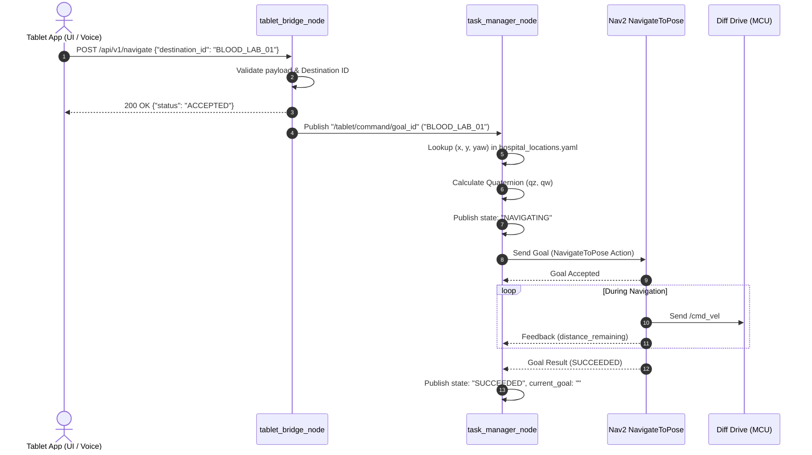
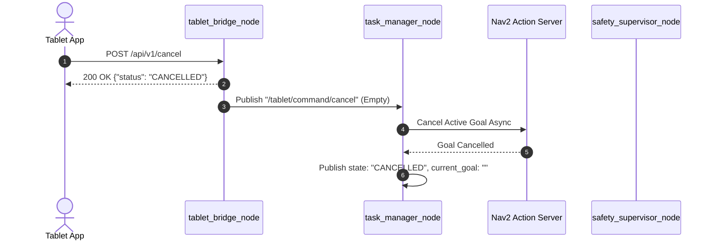
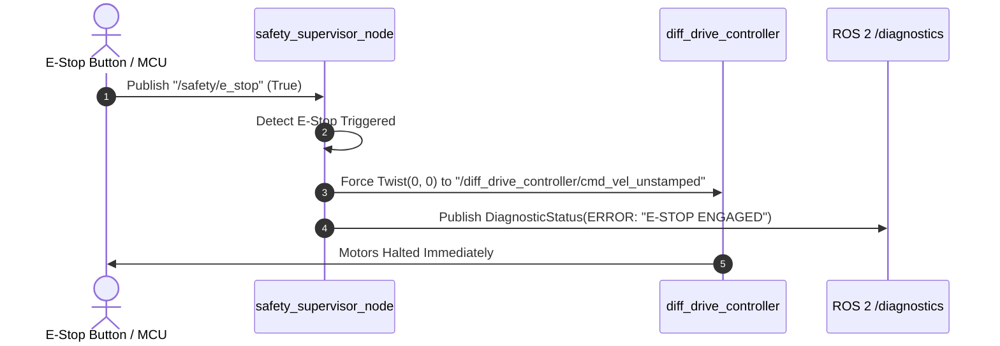

# Kiến trúc Node & Canonical Topic Map

Tài liệu này giải thích chi tiết cấu trúc các node trong hệ thống điều hướng Robot Bệnh viện (Phase 1 Prototype), luồng dữ liệu giữa các subsystem và cơ chế hoạt động của **Canonical Topic Map** (`config/topic_map.yaml`).

---

## 1. Sơ đồ kiến trúc tổng thể (Architecture Overview)

```mermaid
flowchart TD
    subgraph UI ["Lớp Giao Tiếp Người Dùng (External Tablet)"]
        Tablet["Tablet App (Voice AI / Touch UI)"]
    end

    subgraph InterfaceSubsystem ["1_robot_interface"]
        Bridge["tablet_bridge_node (FastAPI Port 8000)"]
    end

    subgraph NavSubsystem ["4_robot_navigation"]
        TaskManager["task_manager_node (Mission State Machine)"]
        Locations[("hospital_locations.yaml")]
    end

    subgraph Nav2Stack ["Nav2 Navigation Stack"]
        Nav2Action["NavigateToPose Action Server"]
        Costmaps["Global / Local Costmaps"]
        Planner["Controller & Planner Server"]
    end

    subgraph ControlSubsystem ["5_robot_control"]
        Safety["safety_supervisor_node"]
        Mux["twist_mux"]
        DiffDrive["diff_drive_controller (ros2_control)"]
    end

    subgraph Hardware ["Hardware / MCU"]
        MCU["MCU Motion Controller (Dual Hub Motors & Encoders)"]
        EStop["Hardware E-Stop Switch"]
    end

    %% Data Flow Connections
    Tablet -->|POST /api/v1/navigate| Bridge
    Tablet -->|POST /api/v1/cancel| Bridge

    Bridge -->|"/tablet/command/goal_id"| TaskManager
    Bridge -->|"/tablet/command/cancel"| TaskManager

    Locations -.->|Lookup (x, y, yaw)| TaskManager

    TaskManager -->|NavigateToPose Action Goal| Nav2Action
    Nav2Action -->|Action Feedback & Result| TaskManager

    Nav2Action --> Planner
    Planner -->|"/cmd_vel_nav"| Mux
    Mux -->|"/diff_drive_controller/cmd_vel_unstamped"| DiffDrive
    DiffDrive --> MCU

    EStop -->|"/safety/e_stop"| Safety
    MCU -->|"/mcu/motor_status"| Safety
    Safety -->|Emergency Halt (Zero Twist)| DiffDrive
    Safety -->|"/diagnostics"| TaskManager
```

---

## 2. Chi tiết các Node cốt lõi

### 2.1. `tablet_bridge_node` (Package: `robot_interface`)
* **Mục đích:** Cầu nối trung gian (Gateway) giữa ứng dụng Tablet trên mạng LAN và hệ thống ROS 2 chạy trên Jetson Orin.
* **Mô hình thực thi (Concurrency):** Chạy đồng thời FastAPI Server trên một thread và `rclpy.spin()` trên daemon thread để đảm bảo non-blocking khi nhận HTTP request từ Tablet.
* **REST API Endpoints:**
  | Endpoint | Method | Payload mẫu | Chức năng | Topic ROS 2 publish |
  | :--- | :--- | :--- | :--- | :--- |
  | `/api/v1/navigate` | `POST` | `{"destination_id": "BLOOD_LAB_01"}` | Gửi lệnh điểm đến | `/tablet/command/goal_id` (`std_msgs/String`) |
  | `/api/v1/cancel` | `POST` | *Không có* | Hủy dẫn đường / dừng xe | `/tablet/command/cancel` (`std_msgs/Empty`) |
  | `/api/v1/health` | `GET` | *Không có* | Kiểm tra sức khỏe bridge | *None* |

---

### 2.2. `task_manager_node` (Package: `robot_navigation`)
* **Mục đích:** Quản lý vòng đời nhiệm vụ điều hướng, chuyển đổi tên phòng thành tọa độ bản đồ 2D và giao tiếp với Nav2.
* **Tra cứu tọa độ ngữ nghĩa (`config/hospital_locations.yaml`):**
  Khi nhận được chuỗi `"BLOOD_LAB_01"`, node tra cứu file yaml:
  ```yaml
  locations:
    BLOOD_LAB_01:
      frame_id: "map"
      x: 12.45
      y: -3.20
      yaw: 1.57 # Radian
  ```
  Node tự động tính toán Quaternion từ góc Euler `yaw`:
  $$q_z = \sin(\text{yaw} / 2), \quad q_w = \cos(\text{yaw} / 2)$$
* **Giao tiếp Nav2 Action:** Sử dụng `ActionClient(NavigateToPose, 'navigate_to_pose')` để gửi goal bất đồng bộ, theo dõi feedback khoảng cách còn lại, và nhận kết quả hoàn thành/thất bại.
* **Máy trạng thái điều hướng (`navigation_state`):**
  * `IDLE`: Robot đang đứng yên chờ nhiệm vụ.
  * `NAVIGATING`: Đang dẫn đường đến điểm đích.
  * `SUCCEEDED`: Đã đến đích thành công.
  * `FAILED`: Không tìm được đường đi hoặc bị hủy bởi Nav2.
  * `CANCELLED`: Người dùng hủy lệnh qua Tablet.
  * `ERROR: NAV2_OFFLINE`: Action Server của Nav2 chưa hoạt động.

---

### 2.3. `safety_supervisor_node` (Package: `robot_control`)
* **Mục đích:** Giám sát an toàn phần cứng mức thấp, bảo vệ bệnh nhân và robot trong môi trường bệnh viện.
* **Chức năng:**
  1. **Xử lý E-Stop khẩn cấp:** Subscribe topic `/safety/e_stop`. Khi có tín hiệu `True`, ngay lập tức publish vận tốc bằng 0 (`geometry_msgs/Twist`) đè lên `/diff_drive_controller/cmd_vel_unstamped` để ngắt động cơ.
  2. **Giám sát lỗi động cơ Hub Motor:** Subscribe `/mcu/motor_status` (từ MCU telemetry), phát hiện các cờ lỗi như kẹt động cơ (stall), quá nhiệt (overheat), mất kết nối driver.
  3. **Xuất báo cáo chẩn đoán:** Publish định kỳ 1Hz lên `/diagnostics` (`diagnostic_msgs/DiagnosticArray`) theo chuẩn của ROS 2.

---

## 3. Bản đồ Topic Chuẩn — Canonical Topic Map (`config/topic_map.yaml`)

### 3.1. Tại sao phải sử dụng Canonical Topic Mapping?

Trong các hệ thống robot phức tạp, các lập trình viên thường mắc lỗi **hardcode** trực tiếp tên topic vào source code (ví dụ `self.create_subscription(String, "/tablet/goal", ...)`). Điều này dẫn đến các rủi ro:
1. **Dễ đứt gãy kết nối (Silent Failure):** Khi nhóm cảm biến hoặc nhóm Nav2 thay đổi tên topic, các node khác không biết và không nhận được dữ liệu nhưng không hề báo lỗi compile.
2. **Khó cấu hình đa robot (Multi-Robot Fleet):** Không thể chuyển đổi namespace thành `/robot_01/...` hay `/robot_02/...` một cách linh hoạt.
3. **Phân rã giai đoạn phát triển:** Khó phân biệt tính năng nào đã kích hoạt trong Sprint 1 (`ACTIVE`) và tính năng nào dành cho tương lai (`PHASE 2`).

**Quy tắc:** `config/topic_map.yaml` là **Single Source of Truth** duy nhất của toàn bộ hệ thống. Mọi node phải truy vấn topic thông qua `TopicMapper`.

---

### 3.2. Cấu trúc phân cấp 5 tầng (Subsystem Hierarchy)

Canonical Topic Map chia hệ thống thành 5 phân hệ rõ ràng:

| Phân hệ | Mục đích | Tiền tố canonical chuẩn | Trạng thái Phase 1 |
| :--- | :--- | :--- | :--- |
| **1. Interface** | Giao tiếp Tablet, Cloud & HRI | `/robot_{id}/interface/` | `goal_id`, `cancel_task` hoạt động |
| **2. Sensors** | Dữ liệu thô từ phần cứng (LiDAR, Camera, Wheel) | `/robot_{id}/sensors/` | `/scan`, `/camera/depth/...`, `/joint_states` |
| **3. Perception** | Lọc chướng ngại vật & phát hiện người | `/robot_{id}/perception/` | `/scan_filtered` |
| **4. Navigation** | Định vị (AMCL), Costmap, Lập kế hoạch, Mission | `/robot_{id}/navigation/` | `/map`, `/plan`, `/task_manager/...` |
| **5. Control** | Safety supervisor, ros2_control & MCU | `/robot_{id}/control/` | `/safety/e_stop`, `/mcu/...`, `/diagnostics` |

---

### 3.3. Bảng tra cứu toàn diện các Topic trong `topic_map.yaml`

| Topic Key trong YAML | Canonical Topic Name | Kiểu Message ROS 2 | Trạng thái | Mục đích sử dụng |
| :--- | :--- | :--- | :--- | :--- |
| `interface.tablet.goal_id` | `/tablet/command/goal_id` | `std_msgs/String` | **ACTIVE** | Tablet gửi Semantic ID (ví dụ: `BLOOD_LAB_01`) |
| `interface.tablet.cancel_task` | `/tablet/command/cancel` | `std_msgs/Empty` | **ACTIVE** | Tablet gửi tín hiệu dừng/hủy |
| `interface.tablet.robot_status`| `null` | — | *PHASE 2* | Trạng thái phản hồi về Tablet |
| `interface.tablet.battery_level`| `null` | — | *PHASE 2* | Dung lượng pin hiển thị trên Tablet |
| `sensors.lidar_2d.scan_raw` | `/scan` | `sensor_msgs/LaserScan` | **ACTIVE** | Quét 2D từ cảm biến LiDAR |
| `sensors.camera_depth.depth_raw`| `/camera/depth/image_rect_raw` | `sensor_msgs/Image` | **ACTIVE** | Ảnh depth thô từ camera |
| `sensors.camera_depth.pointcloud`| `/camera/depth/color/points` | `sensor_msgs/PointCloud2`| **ACTIVE** | Đám mây điểm 3D phát hiện vật cản treo |
| `sensors.wheel_odom.joint_states`| `/joint_states` | `sensor_msgs/JointState` | **ACTIVE** | Phản hồi encoder từ MCU |
| `perception.obstacle_processing.filtered_scan` | `/scan_filtered` | `sensor_msgs/LaserScan` | **ACTIVE** | Laser scan đã cắt lọc footprint robot |
| `navigation.localization.amcl_pose` | `/amcl_pose` | `geometry_msgs/PoseWithCovarianceStamped` | **ACTIVE** | Tọa độ robot định vị bởi AMCL |
| `navigation.mapping.static_map`| `/map` | `nav_msgs/OccupancyGrid` | **ACTIVE** | Bản đồ tĩnh bệnh viện |
| `navigation.planning.global_plan`| `/plan` | `nav_msgs/Path` | **ACTIVE** | Quỹ đạo toàn cục từ Nav2 |
| `navigation.mission.active_goal_id` | `/task_manager/current_goal` | `std_msgs/String` | **ACTIVE** | Điểm đến đang thực thi |
| `navigation.mission.navigation_state` | `/task_manager/state` | `std_msgs/String` | **ACTIVE** | Trạng thái máy trạng thái (IDLE, NAVIGATING, ...) |
| `control.command.cmd_vel_out` | `/diff_drive_controller/cmd_vel_unstamped` | `geometry_msgs/Twist` | **ACTIVE** | Vận tốc cuối cùng truyền xuống MCU |
| `control.safety.emergency_stop` | `/safety/e_stop` | `std_msgs/Bool` | **ACTIVE** | Tín hiệu dừng khẩn cấp |
| `control.mcu_telemetry.motor_status` | `/mcu/motor_status` | `std_msgs/String` | **ACTIVE** | Mã lỗi driver & tình trạng động cơ |
| `control.mcu_telemetry.diagnostics` | `/diagnostics` | `diagnostic_msgs/DiagnosticArray` | **ACTIVE** | Báo cáo chẩn đoán hệ thống |

---

## 4. Cách sử dụng `TopicMapper` trong mã nguồn

### 4.1. Bản chất hoạt động của `TopicMapper`

Lớp `TopicMapper` (đặt tại `src/robot_bringup/robot_bringup/topic_mapper.py`) nhận đường dẫn file `topic_map.yaml` và cung cấp phương thức `resolve(key_path: str) -> Optional[str]`:

```python
from robot_bringup.topic_mapper import TopicMapper

mapper = TopicMapper("path/to/topic_map.yaml")

# 1. Truy vấn topic đang kích hoạt (ACTIVE):
goal_topic = mapper.resolve("interface.tablet.goal_id")
# -> Trả về chuỗi: "/tablet/command/goal_id"

# 2. Truy vấn topic chưa kích hoạt (PHASE 2 - mang giá trị null):
status_topic = mapper.resolve("interface.tablet.robot_status")
# -> Trả về: None

# 3. Truy vấn sai key:
mapper.resolve("invalid.subsystem.key")
# -> Raise KeyError: "Topic key 'invalid.subsystem.key' not found in topic_map.yaml"
```

### 4.2. Mẫu lập trình chuẩn cho một ROS 2 Node

Dưới đây là mẫu lập trình chuẩn được áp dụng trên tất cả các node trong repository:

```python
from rclpy.node import Node
from std_msgs.msg import String
from robot_bringup.topic_mapper import TopicMapper

class StandardHospitalNode(Node):
    def __init__(self, topic_map_path: str):
        super().__init__('standard_hospital_node')
        
        # 1. Khởi tạo TopicMapper
        self.mapper = TopicMapper(topic_map_path)
        
        # 2. Phân giải topic động
        goal_topic = self.mapper.resolve("interface.tablet.goal_id")
        
        # 3. Tạo Subscriber/Publisher với topic đã được phân giải
        if goal_topic:
            self.sub_goal = self.create_subscription(
                String, 
                goal_topic, 
                self.goal_callback, 
                10
            )
            self.get_logger().info(f"Subscribed to goal topic: {goal_topic}")
        else:
            self.get_logger().warn("Goal topic is not active in this phase.")

    def goal_callback(self, msg: String):
        self.get_logger().info(f"Received: {msg.data}")
```

---

## 5. Luồng tuần tự (Sequence Diagrams)

### 5.1. Luồng gửi lệnh điều hướng (Dispatch Goal)



### 5.2. Luồng hủy nhiệm vụ / Dừng xe (Cancel Goal)



### 5.3. Luồng dừng khẩn cấp E-Stop (Emergency Stop)



---

## 6. Tổng kết các nguyên tắc dành cho Developer

1. **Tuyệt đối không hardcode:** Không bao giờ gõ trực tiếp tên topic dạng string `"/scan"` hay `"/tablet/command/goal_id"` bên trong thân logic của node.
2. **Luôn sử dụng dot-notation:** Tra cứu thông qua key path dạng `subsystem.group.topic_name` (ví dụ: `interface.tablet.goal_id`).
3. **Kiểm tra giá trị Null (Phase 2):** Khi gọi `mapper.resolve(...)`, luôn kiểm tra xem kết quả có phải là `None` hay không trước khi khởi tạo Publisher hoặc Subscriber.
4. **Cập nhật tập trung:** Khi cần thay đổi tên topic cho toàn bộ robot, chỉ chỉnh sửa duy nhất tại [topic_map.yaml](file:///home/binhnguyenduc/Documents/hospital_robot_ws/src/robot_bringup/config/topic_map.yaml). Toàn bộ các node sẽ tự động nhận diện tên mới mà không cần sửa code.

